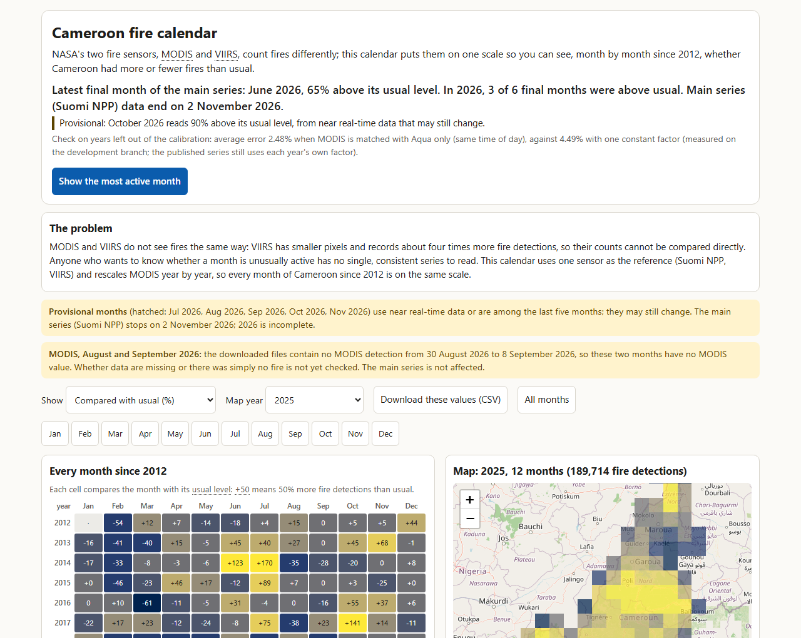

# Cameroon fire calendar: MODIS and VIIRS harmonized

NASA Space Apps Challenge 2026, challenge "Harmonizing MODIS and VIIRS fire hotspots".

**Live app: https://kahadjie.github.io/cameroon-fire-calendar/**

**Team WESH MIS** (WorldWide Emergent Smart Hub), Cameroon: Kenmoe Kahadjie Felix (sole member).

## In 30 seconds

- **Problem**: NASA's two fire sensors, MODIS and VIIRS, count fires differently (VIIRS records about
  four times more detections), so nobody can read one consistent fire history to say whether a month
  is unusually active.
- **Solution**: a calendar of every month since 2012 for Cameroon, on one scale: Suomi NPP (VIIRS) is
  the reference and MODIS is rescaled year by year. The page opens on a generated sentence: the latest
  final (not provisional) month of the main series and how far it is from its usual level; the latest
  provisional month is shown apart, on its own line. Main series data end on
  2 November 2026, the last day Suomi NPP delivers near-real-time data.
- **One figure**: on years left out of the calibration, the error of the MODIS → VIIRS rescaling is
  4.49% with one constant factor and 2.48% when MODIS is matched with Aqua only (measured; the
  published series still uses each year's own factor).
- **Try it**: https://kahadjie.github.io/cameroon-fire-calendar/



A static web application (one page, `index.html`, Leaflet from a CDN, no server) that shows, for all of
Cameroon, a month × year calendar of fire hotspots from 2012 to 2 November 2026 (main series). Each
month is compared with its **usual level** (the 2012-2025 median of that month). A map shows detections
per 0.5° cell for the chosen year and months, a "Compare two years" view puts two seasons side by
side, and the values shown can be downloaded as CSV. Technical words are explained on the page
(underlined terms and a "Words used" section).

## Open the application

Double-click `index.html` (the data are in `donnees.js`, no server needed). Leaflet and the base map
come from the internet; without a connection, the calendar and the CSV export still work. Alternative:
`python -m http.server 8000`, then open http://localhost:8000.

## NASA data

All fire data come from **NASA FIRMS** (Fire Information for Resource Management System),
https://firms.modaps.eosdis.nasa.gov, country downloads for Cameroon
(https://firms.modaps.eosdis.nasa.gov/download/):

| Product | FIRMS download | Satellites | Archive | Near real-time (NRT) |
|---|---|---|---|---|
| MODIS Collection 6.1, 1 km | `DL_FIRE_M-C61` | Aqua, Terra | 2012-01-20 → 2026-08-29 | 2026-09-09 → 2026-11-13 |
| VIIRS 375 m, Collection 2 | `DL_FIRE_SV-C2` | Suomi NPP (`SNPP`) | 2012-01-20 → 2026-07-31 | 2026-08-01 → 2026-11-02 |
| VIIRS 375 m, Collection 2 | `DL_FIRE_J1V-C2` | NOAA-20 (`N20`) | 2018-04-01 → 2026-07-31 | 2026-08-01 → 2026-11-13 |
| VIIRS 375 m, Collection 2 | `DL_FIRE_J2V-C2` | NOAA-21 (`N21`) | 2023-03-01 → 2026-07-31 | 2026-08-01 → 2026-11-13 |

Coverage dates are those found in the files by `inspect_archives.py`. Citation (also shown in the
application):

> We acknowledge the use of data and imagery from LANCE FIRMS operated by NASA's Earth Science Data and
> Information System (ESDIS) with funding provided by NASA Headquarters.

Base map: © OpenStreetMap contributors (ODbL). No other data source is used.

## Decisions

1. **Main series: S-NPP alone; sensors are never added together.** S-NPP, NOAA-20 and NOAA-21 often
   pass over the same fire a few minutes apart, so adding their detections would count the same fire
   two or three times. Instead of a space-time de-duplication (fragile and slow), S-NPP is fixed as the
   main series: it is the only VIIRS series covering 2012 to 2026. NOAA-20 and NOAA-21 are used **only
   to cross-check** that series (see Key results).
2. **Nominal and high confidence, on a common scale.** VIIRS gives `l`/`n`/`h`. MODIS gives 0-100,
   converted with the FIRMS thresholds: low < 30, nominal 30-79, high ≥ 80. Low-confidence detections
   are dropped for both sensors.
3. **Archive: `type = 0` only** (presumed vegetation fire), which removes volcanoes, static land sources
   and offshore detections (gas flares). NRT files have no such column, so they keep everything. Effect
   measured on the S-NPP archive: 0.42% of detections.
4. **MODIS → S-NPP-equivalent calibration per year, never a single constant.** For each year:
   factor = S-NPP detections / MODIS detections, over months that are complete for both sensors and
   not provisional. A year without overlap would take the nearest year's factor (and say so).
5. **Incomplete months are left empty, not extrapolated.** A month has a value for a sensor only if it
   is covered from its first to its last day: January 2012 (data start on the 20th), November 2026 for
   S-NPP (NRT ends on 2 November), August and September 2026 for MODIS (no MODIS detection in the
   downloaded files from 30 August to 8 September).
6. **Historical median** of each calendar month over 2012-2025 (167 reference months, excluding
   incomplete and provisional months). Anomaly = (value − median) / median × 100.
7. **Provisional data**: every month containing NRT data, plus the last 5 months (July to November
   2026). They are hatched and announced in a banner; 2026 is marked incomplete.
8. **"Cividis" palette** (8 classes), readable with color vision deficiency and ordered in grayscale.
   Checked by `check_palette.py` (gray levels 30 to 224, at least 22 between two classes) and by a
   grayscale screenshot of the page. Every cell also shows its value as a number.

## Limitations

- **MODIS, 30 August to 8 September 2026**: the downloaded files contain no MODIS detection on these
  days, so August and September 2026 have no MODIS value. NASA's availability service lists MODIS
  standard data up to 31 August and near-real-time data from 1 September, so this may simply be days
  without fire; it is not yet checked. Shown in the application. The main series is not affected.
- **The main series ends on 2 November 2026**: Suomi NPP near-real-time data stop on that day (NASA
  availability service); NOAA-20 and NOAA-21 continue to 14 November 2026 but are only used as a
  cross-check. November 2026 is therefore incomplete.
- **The 2026 factor is 5.942, from 6 months only** (January to June). It is well outside the 2012-2025
  range (3.951 to 4.693), so read it with caution (incomplete year; possibly the end of life of the
  Terra satellite). The 2026 MODIS equivalent depends on it.
- **Rainy season** (June to September): the median drops below 500 detections (104 in September), so a
  few dozen detections give ±70%. The application says so in the month details.
- **Days without detections**: FIRMS files list fires only, so a day without any detection cannot be
  told apart from a day without data. The archives have breaks of more than 3 days: MODIS 134 (121
  starting between June and September), S-NPP 24 (20 between June and September), mostly the quiet
  rainy season. Two S-NPP breaks fall in the fire season and may be data outages: **2 to 7 November
  2024** and **9 to 13 March 2026**. Those months are kept as complete; their counts may be slightly
  low. None of these breaks is confirmed as a data outage.
- A detection is not a fire: a large fire gives several pixels, a small fire under clouds gives none.
  Counts measure detected activity, not burned area.
- NRT files have no `type` column: NRT months may include a few static sources (about 0.4% based on
  the archive).
- Geolocation errors at the country border (FIRMS country window) are not corrected.

## Key results

All figures below come from `aggregats.json`.

- **S-NPP/MODIS factor**: 4.008 (2012) to 4.693 (2025); mean 4.30, standard deviation 0.23 over the
  14 years 2012-2025 (2012 from 11 months, the others from 12); minimum 3.951 (2015). It **rises** after 2020 (4.120 → 4.693), so a single
  constant would bias any comparison between the two periods. Hence one factor per year.
- **Cross-check of the main series** over the reference months: NOAA-20 correlation 0.999 with S-NPP
  (93 months), ratio 0.996; NOAA-21 correlation 0.998 (34 months), ratio 0.961. The S-NPP series is
  stable and consistent with the two other VIIRS sensors, without double counting.
- **Seasonality**: the fire season runs from November to March (medians: January 52,007, February
  55,432, December 42,406.5 detections); July to September each have a median below 250.
- **Annual S-NPP totals** (complete years 2013-2025): from 153,503 (2013) to 208,332 (2020), the
  maximum; 189,714 in 2025.
- **Notable months**: November 2023 at −72.9% (2,847 detections against a median of 10,510.5), a
  strong anomaly in the fire season itself.
- **2026**: January (−24.9%) and February (−32.2%), the most active months, were below their median;
  March (+41.6%) above. July to November 2026 are provisional.
- **Most active month on record** (Suomi NPP): February 2023, 90,395 detections (usual level for
  February 55,432).
- **Held-out test of the rescaling** (each full year 2013-2025 left out in turn, measured on the
  development branch `global`): 4.49% average error with one constant factor, 3.25% from the adjacent
  years, 2.48% when MODIS is matched with Aqua only (same time of day). This is a comparison: the
  published series uses each year's own all-MODIS factor.

## CSV download

The button "Download these values (CSV)" saves the months selected, for the current view, as
`cameroon_fire_calendar_<view>_2012_to_<last day of the main series>.csv` (`<view>`:
`vs_usual_pct`, `detections` or `modis_rescaled`). The first line (starting with `#`) gives the source
and the last day of the main series. Columns:

| Column | Meaning |
|---|---|
| `year`, `month` | the month |
| `value_shown` | the value displayed in the calendar for the chosen view |
| `view` | `anomaly`, `snpp` or `modis_equiv` |
| `snpp` | Suomi NPP detections (main series); empty if the month is not complete |
| `modis` | MODIS detections (Aqua + Terra); empty if not complete |
| `modis_as_snpp` | MODIS rescaled to Suomi NPP: `modis` × `factor` |
| `factor`, `factor_year` | the rescaling factor and the year it comes from |
| `snpp_median` | usual level: median of that calendar month over 2012-2025 |
| `anomaly_pct` | (`snpp` − `snpp_median`) / `snpp_median` × 100 |
| `n20`, `n21` | NOAA-20 and NOAA-21 detections (cross-check only, never added) |
| `provisional` | 1 if the month may still change |
| `modis_complete` | 1 if MODIS covers the whole month |

## Reproduce

Requirements: Python 3.13 (pandas has no release for Python 3.15 yet) and pandas.

```
pip install pandas
python test_harmonize.py      # 10 tests on synthetic data
python -m pytest              # the same 10 tests + the summary-sentence test (11)
python inspect_archives.py    # checks the real files in data/ (dates, satellites, confidence, breaks)
python harmonize.py           # writes aggregats.json, grille.json and donnees.js
python check_palette.py       # grayscale palette check
```

`data/` (raw FIRMS archives, not versioned): download the "Country: Cameroon" archives for MODIS C6.1
and VIIRS S-NPP, NOAA-20, NOAA-21 from https://firms.modaps.eosdis.nasa.gov/download/ and extract them
into `data/modis`, `data/snpp`, `data/noaa20`, `data/noaa21`. No API key is used.

## Files

| File | Role |
|---|---|
| `index.html` | the application (map, calendar, CSV export) |
| `donnees.js` | aggregates loaded by the page (same content as the two JSON files) |
| `aggregats.json` | month × year: S-NPP, MODIS, S-NPP equivalent, factor, NOAA-20/21, median, anomaly, provisional flag, completeness |
| `grille.json` | S-NPP detections per 0.5° cell and per month (map); no individual detections |
| `harmonize.py` | loading, common confidence scale, filters, calibration, medians, anomalies |
| `test_harmonize.py` | unit tests |
| `inspect_archives.py` | inspection of the real files |
| `check_palette.py` | grayscale palette check |
| `summary.js` | the summary sentences at the top of the page, computed from the data |
| `test_summary.py`, `tests/summary_test.html` | test of those sentences in a headless browser (skipped if none is installed) |
| `docs/AUDIT.md` | audit against the five judging criteria |
| `docs/DEMO_PLAN.md` | 30-second and 2-minute scripts, 7 slides |
| `submission/DESCRIPTION.md` | submission text |

The repository contains only aggregates: no raw detection, no key, no personal data.

## Status

Done:
- [x] Harmonized calendar for Cameroon, 2012 to 2 November 2026 (main series) — [index.html](index.html)
- [x] Generated summary sentence, plain-language labels, explained terms — [index.html](index.html)
- [x] Validation shown on the page (held-out test, cross-check with NOAA-20/21) — [Key results](#key-results)
- [x] Compare two years, CSV download with documented columns — [CSV download](#csv-download)
- [x] Checked at 390 px width, in grayscale, and with the keyboard (Tab, Enter, arrow keys)
- [x] Audit against the judging criteria — [docs/AUDIT.md](docs/AUDIT.md)
- [x] Demo scripts and slide plan — [docs/DEMO_PLAN.md](docs/DEMO_PLAN.md)
- [x] Submission text — [submission/DESCRIPTION.md](submission/DESCRIPTION.md)

Remaining:
- [ ] Record the demo video from [docs/DEMO_PLAN.md](docs/DEMO_PLAN.md)
- [ ] Submit the NASA Space Apps form (description, app link, video) before 15 November 2026, 23:59 (Cameroon)
- [ ] Check with NASA FIRMS whether MODIS has data from 30 August to 8 September 2026

## Roadmap

- Any country, with automatic updates every 6 hours (built on the development branch `global`, not
  merged).
- Rescale MODIS with Aqua only (same time of day as VIIRS), once validated.
- Fire radiative power (FRP) next to counts.

## Use of AI

This project was built with the help of **Claude** (Anthropic), an AI assistant, working under the
direction and review of the team (Kenmoe Kahadjie Felix):

- **Code**: Claude wrote `harmonize.py`, `test_harmonize.py`, `inspect_archives.py`,
  `check_palette.py` and `index.html` (layout, calendar, map, CSV export), from a written plan and the
  team's decisions (S-NPP as main series, per-year calibration, confidence filter, flagged incomplete
  months), and the summary sentence, explanations and "Compare two years" view.
- **Data checks**: Claude ran the tests and the inspection of the real FIRMS files, and compared the
  figures in this README with `aggregats.json`.
- **Documentation**: Claude drafted this README, the English translation of the interface, the
  submission description, the audit (`docs/AUDIT.md`) and the demo plan.

The data themselves are NASA FIRMS data, unchanged; no AI-generated data, image or figure is presented
as observed data. The team reviewed and approved the choices and the results.

## Data license

NASA FIRMS data: free to use with the citation above. OpenStreetMap base map: ODbL.
